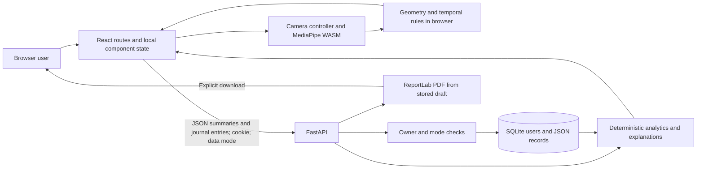
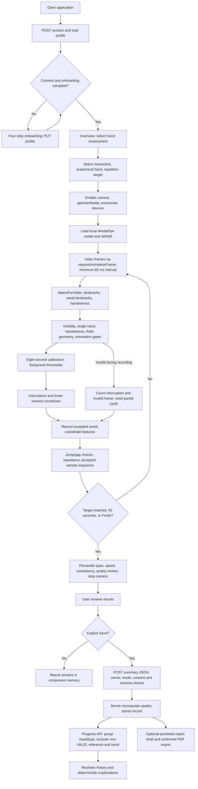
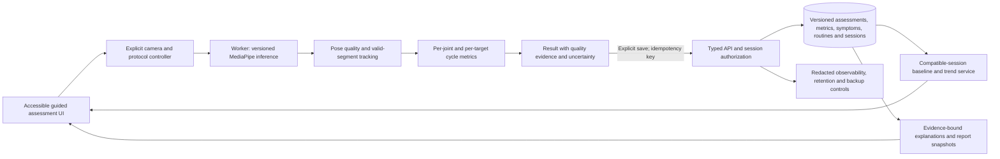

# ArthriTrack — Technical Audit, Pipeline Analysis & Improvement Roadmap

Audit date: **15 October 2026 (Asia/Singapore)**. Repository HEAD: `16293d1` (`Initial commit: ArthriTrack application`). Scope: inspection, read-only/in-memory verification, and planning. No application source changes were made.

## 1. Executive Summary

ArthriTrack is a functional **hand-movement self-care prototype**, not a general joint-assessment platform or a validated arthritis monitor. Its active application performs genuine browser-side MediaPipe inference, derives movement features across multiple frames, counts repetitions, computes descriptive metrics, and explicitly saves summaries to a user-isolated database. Symptom journaling, daily care routines, rule-based explanations, progress charts, JSON export, and PDF generation have implemented backend paths.

The most important architectural distinction is between the active application and its preserved legacy implementation. `frontend/src/main.tsx:4` imports `src/App.tsx`; startup scripts and Docker launch `backend/app.py`. Neither imports the legacy application. The old frontend has fabricated fallback results; the old backend has seeded history and Isolation Forest analysis. Those are **not the active pipeline**.

The active implementation is substantially more responsible: it separates demo data, states measurement limitations, excludes uncertain results from references, and keeps camera frames on the device. However, correctness of landmark detection does not establish correctness of its mobility measurements. The principal weaknesses are:

1. Thumb-opposition range and speed mix different fingertip targets into one signal, creating changes unrelated to physical movement.
2. Speed can bridge invalid tracking segments, and there is no application-level smoothing or cycle-level measurement.
3. Quality status is a frame/repetition heuristic, not accuracy confidence; the API accepts even a one-frame assessment as `VALID` when other client-supplied fields satisfy its rule.
4. The same trend threshold floor is applied to degrees, normalized proximity, speed and percentages, producing inappropriate comparisons.
5. History, deletion semantics, timestamp handling and production identity need work before dependable long-term use.

**Recommended direction:** stabilize the existing landmark-and-rules approach, establish measurement definitions and reproducibility, then improve accessibility and longitudinal interpretation. An additional ML model is not the immediate solution.

### Evidence and verification boundaries

Labels used throughout:

- **Confirmed:** directly established by source, configuration, schema inspection, or an executed check. Source inspection establishes implementation, not successful physical-device operation.
- **Inference:** a reasoned consequence of the implementation; reproduction on actual hardware or under concurrency is still required.
- **Unverified:** requires runtime, physical devices, deployment, representative participants, or external evidence unavailable in this audit.
- **Proposed:** future work, not an existing capability.

Inspected all tracked application source, legacy source, tests, project configuration, migrations and documentation. Inspected dependency manifests and lockfile version metadata, local model asset presence, and both SQLite schemas using read-only connections. Existing health-record contents were not needed or inspected. Vendored WASM/model binaries and third-party dependency implementations were not audited internally. Two existing `backend/pytest-cache-files-*` directories denied enumeration; these are generated artifacts, not tracked application source. No applicable `AGENTS.md` was found in the searched project/parent locations.

Executed checks:

| Check | Result and boundary |
|---|---|
| Existing backend suite | **15 passed**, one Starlette/httpx deprecation warning. Executed with Python `-B`, pytest cache disabled, and process-only overrides replacing the test temporary database with SQLite memory plus `StaticPool`. No source or disk database modified; this does not verify disk locking or migration behavior. |
| Frontend type check | `tsc -p tsconfig.app.json --noEmit --incremental false`: **passed**. No build artifacts generated. |
| Pure geometry/engine probes | Loaded actual TypeScript through in-memory transpilation. Confirmed right-angle calculation, invalid geometry rejection, invalid-segment speed bridging, and opposition target-switch discontinuity. |
| Targeted API/analytics probes | In-memory database confirmed one-frame `VALID`, 201 stored assessments versus 200 default list results, retained report copies after assessment deletion, and missed large relative opposition change. |
| Existing database schemas | Read-only inspection confirmed legacy `assessments`/`symptom_records` and active `users`/`records`/`alembic_version`. |
| Earlier verification | `docs/VERIFICATION.md:3–21` reports 15 backend, 6 Vitest and 4 Playwright passes plus build/migration checks on 13 October. Those are historical claims, not fresh browser/build results from this audit. |

The physical camera journey, full Vitest runner, Playwright journey, production build, dependency vulnerability scan, Docker, PostgreSQL, HTTPS, screen readers and clinical accuracy were **not freshly verified**. Existing browser tests write screenshots and create server records; builds write output. They were not run against the workspace under the instruction that only this report may be created. No credentials are required for the active deterministic explanation provider.

## 2. Current Application Capabilities

“Implemented” below means a real code path exists. It does not imply clinical validation or complete production readiness.

| Capability | Status | Evidence and qualification |
|---|---|---|
| Four-step onboarding, profile and consent | Implemented | `pages/Onboarding.tsx:4–8`; `backend/app.py:148–161`. Progress saved after each step; no back/edit-all flow. |
| Private browser identity | Implemented for local MVP | Random cookie token, hashed database lookup; no account recovery or cross-device login. `app.py:37–41,148–155`. |
| Camera selection and live overlay | Implemented; physical operation unverified | `pages/Assessment.tsx:18–58,62`. Actual stream, model and canvas; no simulated fallback in active code. |
| Hand landmark inference | Genuine pretrained AI | `vision/tracker.ts:1–4`; model and WASM assets served locally. |
| Fist, spread and thumb opposition | Implemented experimental algorithms | `vision/geometry.ts:9–16`; `vision/engine.ts:19–47`. One selected hand at a time. |
| Full-body, wrist ROM, individual MCP/DIP assessments | Missing | No pose model, forearm landmarks or corresponding assessment paths. Wrist landmark is a geometric anchor, not wrist-ROM measurement. |
| Calibration and repetition detection | Partial measurement implementation | Eight-second movement calibration; personalized fist/spread thresholds. Opposition still uses fixed thresholds. |
| ROM, speed, consistency | Implemented proxies | Multi-frame descriptors; not goniometer-equivalent ROM or validated clinical scores. |
| Tracking confidence | Partial | Visibility, hand identity, jumps and orientation checks. No per-joint confidence or calibrated measurement uncertainty. |
| Assessment save/history/delete | Implemented with defects | `app.py:162–174`; list pagination not consumed by dashboard; saved report snapshots survive deletion. |
| Baselines and trends | Implemented heuristics | First three valid sessions, last-three comparison after six. No statistical validation or temporal spacing requirements. |
| Bilateral comparison | Missing in active UI/analytics | Hand selector gives separate histories; no paired-session comparison. Legacy comparison charts are inactive. |
| Symptom journal | Implemented | Create/edit/delete, self-report chart and date filter. Chronological/timezone problems remain. `Care.tsx:7–11`. |
| Care routine | Implemented daily-only | CRUD and status logs; reminder checks every minute while open. No push, dose checking or treatment recommendation. |
| “AI Companion” | Implemented deterministic templates | `services/analytics.py:14–21`, `provider.py:14–23`. No LLM or arthritis-trained model. |
| Appointment preparation/PDF | Implemented | Persisted draft, confirmation, real ReportLab PDF. Units and report content completeness need improvement. |
| Privacy export/account deletion | Implemented | JSON includes both modes; FK cascade removes owned records. No individual report/insight deletion endpoint. |
| Demo mode | Explicitly synthetic seed data | `app.py:241–253`; mode-scoped ownership. Live camera results can also be saved to demo space, despite blanket synthetic banner. |
| Production operations/clinical validation | Missing or unverified | No account recovery, encrypted database setup, backup automation, rate limiting, CI or measurement study artifacts. |

File paths beginning `pages/`, `components/` or `vision/` in this report are relative to `frontend/src/`; other backend references specify `backend/` or occur within explicitly identified backend context.

## 3. Repository Architecture

### Active components

| Layer | Implementation and responsibilities |
|---|---|
| Entry and routing | `frontend/index.html:12` → `src/main.tsx:1–10` → `App.tsx:18–27`. React StrictMode, BrowserRouter, eight routes plus not-found state. |
| App state | React state/effects per page; refs for camera/engine state. `api.ts:3–4` holds mutable module-level mode plus localStorage. No global store/query cache. Shell remounts page tree on mode/revision change. |
| Presentation | Shared `UI.tsx:4–9`, Recharts `Trends.tsx`, `pages/Care.tsx`; Lucide icons and inline SVG hand illustration. Active CSS is `index.css`, not template `App.css`. |
| CV controller | `Assessment.tsx` owns camera lifecycle, state transitions, frame sampling, quality gates, canvas drawing and save action. |
| CV calculations | `tracker.ts` initializes MediaPipe; `geometry.ts` computes spatial features; `engine.ts` aggregates temporal samples and repetitions. |
| API transport | `api.ts:5–10`: same-origin `/api`, cookies included, JSON input, `X-Data-Mode`, JSON/PDF output. |
| Backend | FastAPI monolith `backend/app.py`: models, identity, validation, routes and persistence helpers. Small services handle analytics, explanations and PDF. |
| Persistence | SQLAlchemy plus Alembic; SQLite by default, optional psycopg/PostgreSQL URL. Two domain tables plus migration version table. |
| Development | Vite localhost proxy → Uvicorn. PowerShell scripts run migration/startup and Vite. |
| Container deployment | Nginx static frontend/API proxy → backend container → SQLite named volume. Backend runs as non-root; frontend binds host loopback. |

### Dependencies, assets and configuration

`frontend/package.json:14–35` declares React, React Router, MediaPipe Tasks Vision, Recharts, Lucide, Framer Motion, Tailwind, Vite, TypeScript, Vitest and Playwright. Lockfile metadata resolves MediaPipe **1.1.0**, React **19.3.0**, React Router **7.18.4**, Recharts **3.10.1**, Vite **6.4.3**, TypeScript **6.0.3**, Vitest **4.1.11**. These are repository lockfile facts, not assertions about latest releases. Active code does not use Framer Motion; legacy code does.

`backend/requirements.txt:1–14` includes FastAPI, SQLAlchemy, Alembic, Pydantic, ReportLab, HTTPX, pytest and psycopg, plus NumPy/Pandas/SciPy/scikit-learn and multipart support not used by the active measurement pipeline. A pinned `requirements.lock.txt` exists, but README installation and `backend/Dockerfile:3–4` install the **unpinned** requirements file. Separate runtime/test dependencies and use a verified lock consistently.

The local hand model is 7,819,105 bytes; `public/vision/wasm/` includes SIMD/non-SIMD runtime variants. Runtime asset paths are hardcoded absolute root paths. No model checksum/version manifest is persisted with assessments. A dependency update could diverge from vendored WASM without an automated compatibility check. Binary provenance is stated in README but was not cryptographically verified here.

Environment variables are `DATABASE_URL`, `ALLOWED_ORIGINS`, `COOKIE_SECURE`, `TREND_CHANGE_FRACTION`. No dotenv loader exists. Database location depends on working directory. `TREND_CHANGE_FRACTION` is parsed at import without range/finite validation. Compose supplies a fixed SQLite URL and localhost origin, exposing only cookie security as substitution; changing shell `DATABASE_URL` alone will not override that Compose value (`docker-compose.yml:4–7`).

### Legacy and unused material

- `frontend/legacy-App.tsx:290–312` uses 2D distances and arbitrary scaling for instantaneous metrics. Lines 345–376 substitute nonzero fallback values and display locally generated results after failed saves; lines 110–153 and 595–615 fabricate fallback dashboard/chart data. Repetitions are inferred from one metric, not counted.
- `backend/legacy_app.py:88–202` seeds synthetic records without active-style mode separation. `compute_insights`, lines 331–380, fits `IsolationForest(contamination=0.2, random_state=42)` to ROM values after six records and predicts the latest value included in training. It mixes assessment types and hands; this is inactive anomaly detection, not an arthritis model.
- Legacy rehabilitation buttons lack handlers (`legacy-App.tsx:835–869`). Active care routines are a different feature.
- `backend/.dockerignore:4` excludes legacy backend source. Frontend build entry/TypeScript source scope exclude the legacy App from active compilation; Tailwind source scanning may still encounter old classes, which was not bundle-profiled.
- Template `frontend/README.md`, unused `src/App.css`, React/Vite SVGs and unused hero asset add maintenance noise. No recommendation here authorizes deleting them during this audit.

## 4. Actual End-to-End Pipeline

The loop continues inference during calibration, instructions, countdown and pause. Only `RECORDING` sends samples into the assessment engine. Invalid frames return to ongoing sampling; they are not transformed into valid samples. No video file capture, frame upload, backend pose inference or diagnosis stage exists.

| Stage / trigger | Files and functions | Input → processing / output → next stage | Failure points |
|---|---|---|---|
| Open application | `App.tsx:18–24`, `app.py:148–161`, `session` | Cookie → hash lookup or new user → profile; UI requires consent and step 4 | Cookie loss creates inaccessible old profile; no recovery. Development StrictMode can issue duplicate initial requests. |
| Configure assessment | `Assessment.tsx:12–14,61–62` | Hand, kind, target 3/5/8 → React state and refs | Target is not saved as protocol metadata; default left ignores profile affected hand. |
| Enable camera | `open`, lines 18–27 | Device preference → video-only stream requested at 640×480, default front camera → enumerate cameras/load model/play | Permission, insecure context, unavailable device, model failure. Constraints do not guarantee exact dimensions. |
| Acquire frames | `loop`, lines 28–34 | Current decoded video + timestamp → process only new frames at ≥65 ms spacing | Main-thread blocking; no frame-stall watchdog; no device FPS telemetry. |
| Infer landmarks | `tracker.ts:2–4`; `Assessment.tsx:34–43` | Raw video → library preprocessing/inference → 21 normalized and 21 world points per detected hand, handedness | Exactly one hand required; closed-fist occlusion remains unresolved. |
| Apply quality gates | `Assessment.tsx:35–45`; `engine.ts:24–32` | Points → bounds, handedness/score, finite geometry, rotation, gap/jump checks → accepted feature or rejection reason | Handedness inversion unverified; slow rotation can evade gate; no measurement-confidence estimate. |
| Calibrate | `Assessment.tsx:46–49` | Eight seconds accepted features → 10th/90th percentiles → lower/upper hysteresis thresholds | Any rejection restarts calibration; no maximum calibration timeout. Fixed minimum span excludes limited motion. Opposition calibration does not personalize touch thresholds. |
| Start/countdown | `Assessment.tsx:60` | Ready flag → 3-second timer → new engine, recording start | Ready can become stale when video stops delivering frames. |
| Temporal analysis | `AssessmentEngine.process`, `engine.ts:24–39` | World points/time → scalar feature + state machine → samples and repetitions | No sample segment IDs, per-cycle metrics or smoothing; opposition changes signal target. |
| Pause/finish | `Assessment.tsx:17,51–54,62` | Pause adds invalid event; resume subtracts paused time/reset last timestamp. Target/45-second/manual finish → result, stream/model cleanup | Duration limit only evaluated after processed frames. Paused time has no finish button despite instructions saying finish anytime. |
| Compute result | `AssessmentEngine.result`, `engine.ts:41–47`, `quality:50` | Accepted samples → percentile range, derivative mean, variability score, counts → review card | No uncertainty interval; gap bridging; sample-quality ratio ignores skipped/stalled time. |
| Persist | `api.ts:5–8`; `save_assessment`, `app.py:164–169` | JSON → Pydantic/owner/mode/consent checks → quality recomputed → committed record with ID | Trusts client summaries; no idempotency; failed network response can lead to duplicate retry. |
| Progress | `Trends.tsx:5–10`; `analyse`, `analytics.py:4–13` | Saved summaries → hand/type grouping, valid-only values → baseline/category/deltas/all sessions → chart | Unit-insensitive thresholds; lexical timestamp ordering; chart period does not scope summary. |
| Explanation/report | `Care.tsx:18–26`; `app.py:216–235` | Records + request → templates or stored snapshot → UI/PDF | Symptom explanation evidence points at movement; snapshots retain deleted records; PDF omits units. |

## 5. Computer Vision and AI Implementation

### What actually uses AI

`createTracker` explicitly configures `HandLandmarker` in `VIDEO` mode with CPU delegate, maximum two hands, and detection/presence/tracking thresholds of 0.65. The library uses pretrained palm detection and landmark models; video tracking avoids re-running palm detection on every frame when tracking remains adequate. This is genuine inference, with no application training pipeline. [Google Hand Landmarker overview](https://developers.google.com/edge/mediapipe/solutions/vision/hand_landmarker).

The active application imports no OpenCV, TensorFlow.js or PyTorch API. MediaPipe's bundled runtime performs its own model execution; this does not mean the app has no trained model. NumPy/scikit-learn dependencies do not establish active backend ML usage.

| Computation | Classification |
|---|---|
| Hand localization, 21 landmarks and handedness | Pretrained AI inference |
| Distances, angles and normalized proximity | Deterministic geometry |
| Calibration percentiles, dwell/hysteresis, repetitions | Rule-based temporal analysis |
| Quality statuses, consistency percentage and trend categories | Application-defined heuristics |
| Companion responses | Deterministic templates and keyword routing |
| Demo history | Synthetic values explicitly generated by backend |
| Legacy Isolation Forest | Actual but inactive fitted ML anomaly detector |

### Coordinates, preprocessing and supported anatomy

Video is supplied directly to `detectForVideo`; application code does not extract pixel buffers or perform color normalization. MediaPipe handles preprocessing internally. Normalized image points drive canvas overlay and bounds/orientation checks. **World landmarks drive geometry**, so the implemented angle calculation uses estimated 3D coordinates, not 2D screen distances. Google documents world coordinates in metres relative to the hand center; these monocular model outputs should not be treated as calibrated physical metrology. The synchronous web inference calls block the calling thread, matching this app's main-thread implementation. [Google web implementation guide](https://developers.google.com/edge/mediapipe/solutions/vision/hand_landmarker/web_js).

Supported landmarks cover wrist anchor and thumb/finger joints/tips. Fist metrics use four PIP angles; spread uses fingertip rays from the wrist; opposition uses thumb-to-tip distances. The app does not compute all 21 joint angles, MCP/DIP ROM separately, thumb CMC rotation, grip strength, elbow/knee/hip motion or full-body pose.

CSS mirrors both preview and canvas (`index.css:2`); inference receives the unmirrored video element. `Assessment.tsx:35–37` unconditionally swaps MediaPipe left/right labels. **Unverified:** whether this conversion is correct for the installed model and each front/rear camera/browser orientation. A wrong mapping blocks the actual selected hand or mislabels its longitudinal history. The existing empty-frame model test cannot validate this.

### Tracking and quality mechanisms

- Reject anything other than one detected hand, while requesting up to two to identify multi-hand scenes.
- Reject any normalized point outside `[0.025, 0.975]` in either image axis.
- Reject anatomical hand mismatch and handedness score below 0.7. This is classification confidence, **not per-landmark confidence**.
- Reject non-finite/degenerate feature geometry.
- Compare wrist-to-middle-MCP screen rotation to the previous accepted orientation; reject changes exceeding 0.65 radians (~37.2°). This is an in-plane check, not a validated palm-facing or out-of-plane check. Because the reference updates continuously, gradual cumulative rotation can pass.
- Engine rejects a processing gap over 400 ms and any world point jumping more than 1.5 current palm widths since the prior accepted geometry.
- Invalid events reset partial cycles and previous point geometry; counts and sample history remain.

These are useful safeguards but no application-level low-pass, One Euro, Kalman or median trajectory filter is implemented. Library tracking is not proof of validated smoothing. No explicit blur, illumination, camera-distance, palm-normal, scale-stability or occlusion score is computed. A whole-hand interior margin does not ensure sufficient pixel resolution.

`ready` describes the controller's current gates, not the engine's later jump/gap decision. Users can see a reassuring status while the engine rejects a sample. Rejection reasons are deduplicated into a set, with no duration/severity distribution or timestamp trace.

## 6. Joint Mobility Assessment Logic

### Geometry and movement definitions

`geometry.ts:2–7` checks finite coordinates and computes Euclidean 3D distance. For three points A, B, C, define `u=A−B`, `v=C−B`:

`angle(A,B,C) = acos(clamp(dot(u,v)/(length(u)*length(v)), −1, 1)) × 180/π`.

A denominator below `1e−8` returns NaN. This correctly handles the angle between the two segments but does not establish an anatomical joint axis or distinguish signed hyperextension.

`features`, lines 9–16, requires exactly 21 finite points and palm width `W=distance(P5,P17) ≥ 1e−6`:

| Movement | Per-frame scalar | Interpretation |
|---|---|---|
| Fist | Mean of `180−angle(Pi,Pi+1,Pi+2)` for `i=5,9,13,17` | Mean PIP flexion of index/middle/ring/little fingers. Individual angles are computed then averaged; saved range cannot identify which finger changed. |
| Spread | Mean of `angle(P8,P0,P12)`, `angle(P12,P0,P16)`, `angle(P16,P0,P20)` | Adjacent fingertip separation about wrist; not pure MCP abduction. Flexion and relative fingertip geometry can change it. |
| Opposition | `distance(P4, target fingertip)/W`, target in 8,12,16,20 | Dimensionless palm-width proximity to current target; not physical touch, thumb joint angle or pinch strength. |

### Calibration and repetition counting

For fist/spread, calibration collects eight seconds of controller-accepted values, finds P10 and P90, and rejects spans below 12° for fist or 3° for spread. It then sets:

`low=P10+0.25×(P90−P10)` and `high=P10+0.75×(P90−P10)`.

`RepetitionDetector.update` (`engine.ts:3–17`) waits for low → high → low, requiring 180 ms dwell and at least 350 ms between accepted transitions. Completing the final low increments count; it then waits for high again. Invalid events abandon the partial cycle but retain completed repetitions. This is real multi-frame repetition counting, though timestamps use `0` as a sentinel and edge cases need more tests.

Opposition uses fixed approach `<0.28W` held for 180 ms and release `>0.5W`; release increments count and advances finger. One count is **one approach-and-release**, not a complete four-finger sequence. A target of three ends before the little finger is attempted; five gives the index finger extra weight. Calibration records index proximity but does not affect these thresholds (`Assessment.tsx:48–49`; `engine.ts:35–38`).

### Session metrics

`result` (`engine.ts:41–47`) uses all accepted scalar samples, including incomplete cycles:

- **Range:** sorted sample value at `floor(0.95N)` minus value at `floor(0.05N)`, with upper-index bound and zero fallback. This is a robust session feature span; it is not per-joint maximum-minus-minimum ROM or an average of completed-cycle excursions. Short extreme holds can be trimmed out.
- **Speed:** for adjacent stored samples with `0 < Δt < 0.4 s`, compute `abs(Δvalue)/Δt`; average those speeds without time weighting. Units are degrees/s or palm widths/s. This is scalar change speed, not whole-hand velocity.
- **Consistency:** population SD `σ` of those speeds and mean `μ`; return `100×(1−σ/(μ+σ))`, clipped below at zero, or zero when mean is zero. Equivalently `100μ/(μ+σ)`. Natural movement pauses/turnarounds lower this score even for repeatable cycles. It is neither cycle consistency nor a validated 0–100 mobility score.
- **Tracking quality:** usable event count / total event count. The denominator counts engine calls and explicit invalidations, not all camera frames or elapsed tracking coverage. Pause adds an invalid event; unprocessed/stalled frames add none.
- **Duration:** wall time since recording minus explicitly paused time, floored to one second. Involuntary tracking losses remain in duration.

Quality is duplicated in `engine.ts:50` and `app.py:166–168`:

| Status | Rule |
|---|---|
| VALID | Ratio ≥85%, repetitions ≥3, duration ≥5 s, interruptions ≤5 |
| UNCERTAIN | Failing VALID, but ratio ≥65% and repetitions ≥1 |
| RETRY_REQUIRED | Everything else |

There is no minimum accepted sample count, effective sampling rate, minimum usable time, max continuous dropout, uncertainty bound or per-movement rule. `quality_reasons` does not itself affect classification. Saving uncertain/rejected records is intentional and their exclusion from references is implemented.

### Baseline and trend mathematics

`analytics.py:4–13` selects matching hand/type, sorts timestamp strings, includes only `VALID` records and defines reference `B=median(first three valid values)`. It reports population SD of those three as reference variability. At six valid values:

`T=max(abs(B)×TREND_CHANGE_FRACTION, 1)`; default fraction is 0.12.

- All latest three changes strictly below `−T` or above `+T`: **Repeated Change Observed**.
- Otherwise latest-three population SD `>T`: **Variable Measurements**.
- Otherwise: **No Clear Sustained Change**.
- Fewer than six valid values: **Insufficient Data**, even if a three-session reference exists.

`delta` is latest minus reference; `previous_delta` is latest minus previous valid value. Counts, reference dates and all selected sessions are returned. No regression, time weighting, disease classifier, confidence interval, minimum day spacing or baseline-quality threshold exists. Reference variability is returned but not used to set the trend threshold. Deleting early records changes the reference automatically.

## 7. Frontend and UX Review

This is a source-based UX review, supplemented by existing test assertions. It is not a fresh visual inspection or formal accessibility certification.

| Page/component | Strengths confirmed in implementation | Specific improvement |
|---|---|---|
| Shell/navigation (`App.tsx:10,18–27`) | Eight clear destinations, active links, skip link, fallback route, explicit demo banner | Eight horizontally scrolling mobile tabs reduce discoverability. Prioritize overview/assessment/journal/progress and place secondary tools in a menu. “Private local profile” should clearly distinguish local-browser identity from server storage. |
| Onboarding (`Onboarding.tsx:4–8`) | Optional personal fields, explicit consent, no-diagnosis disclosure, persisted progress | Add Back and a summary/edit step. Allow demo exploration without implying real-health-record consent is necessary for a demo. Make readability available before completing onboarding. |
| Overview (`App.tsx:11–16`) | Real API data, empty states, optional plan links, care count | Add loading state and latest movement type; fix default 200-record truncation. Latest symptom currently means last inserted, not latest observation date. |
| Assessment (`Assessment.tsx:62`) | Camera status, overlay, tracking reasons, pause/reset, explicit save, comfort instructions | On smaller layouts guide moves below camera. Show current concise instruction beside/over camera; add phase-aware motion illustration, phone support/distance guidance and optional audio. Current animated Hand icon scales/rotates identically for all movements. |
| Assessment result | Shows units, repetitions, quality, speed, consistency and explicit limitations | Quality review already shows results, then requires another “Review results” click to reach Save. Consolidate into one review card with Save and Retry; distinguish “meets prototype capture rules” from reliable measurement. Preserve unsaved data on navigation or warn. |
| Progress (`Trends.tsx:5–10`) | Separate hand/type/metric, rejected-session gaps, reference line and deletable history | Changing filters retains old chart data until response; show loading/stale marker. Period changes chart/history only, while category/counts remain all-history. Label scopes; use true time axis and accessible data table. “All history” is actually 3650 days. |
| Symptoms (`Care.tsx:7–11`) | Editable dated entries, self-report labels, notes, pain/stiffness charts | Sort by observation time, filter by local date, show filtered-empty state. Add numeric/stepper alternatives to range sliders for limited dexterity. Defaults of zero/none may be saved without deliberate response. |
| Routines (`Care.tsx:13–16`) | Explicit prescribed instructions, four status options, no medication advice, history | Show loading states; distinguish scheduled versus inactive items. Make status writes busy/idempotent; selected reason currently shared across all routine cards. Reset/reconcile reminders immediately after logging. |
| Companion (`Care.tsx:18–21`) | Deterministic mode is disclosed; limitations/evidence are expandable | Rename navigation “Insights” to match actual capability. Evidence must reference the records used in the answer; symptom summaries currently display movement evidence. Show units and selected context with saved explanations. |
| Appointment Prep (`Care.tsx:23–26`) | Explicit section/date selection, review and export confirmation | Add units to downloaded PDF, omitted symptom details, and exact parity between preview and PDF. Explain retained snapshot data and provide draft deletion. Add Unicode font support and bounded report sizes. |
| Settings (`Care.tsx:28–30`) | Readability, JSON export, typed deletion confirmation | Add session/recovery controls before public deployment, consent withdrawal, selective retained-report deletion and edit access to initial profile fields. |
| UI/CSS (`UI.tsx`, `index.css:2–5`) | Native labels, focus outlines, alert/status roles, reduced-motion query, many ≥44px controls, responsive layout | Base body minimum width is 360px, so 320px/reflow layouts overflow. Readability only targets some tags; small spans/links remain. Audit contrast, 200–400% zoom, focus order, chart alternatives and touch use with target users. |

High-frequency tracking text is in a status region; unstable messages could cause excessive screen-reader announcements. Throttle spoken feedback and announce meaningful state changes. Add focus management on route/assessment transitions and clear screen-reader descriptions for progress elements. Many loading/error states exist, but `useRecords` initially renders an empty list and some pages ignore its loading flag; dashboard uses all-or-nothing `Promise.all`. A single endpoint failure hides otherwise available dashboard information.

## 8. Backend and Data Architecture

### Schema and ownership

`app.py:22–33` defines:

- `users(id PK, token_hash unique String(64), profile JSON)`.
- `records(id PK, user_id FK ON DELETE CASCADE, kind String(30), mode String(8), data JSON)`.

Kinds used are assessments, symptoms, routines, logs, insights, reports and consents. Mode is real/demo. Profile is shared across modes. Event dates and domain fields live inside JSON, not indexed typed columns. Migration `001_initial.py:8–12` adds individual owner/kind/mode indexes plus composite `(user_id,mode,kind)`. ORM metadata omits the composite index, so `create_all` tests do not perfectly represent migrated production schema.

Session creation generates `secrets.token_urlsafe(48)`; server stores SHA-256 hash only. Cookie is HTTP-only, SameSite Strict, one-year max age, Secure only when environment says `true`. Record read/update/delete helpers enforce owner, kind and mode (`app.py:37–56`). Account cascade is enabled for SQLite connections. This is useful browser-bound isolation, but no separate session table, server expiry, logout, revocation, recovery or multiple-device authorization exists.

### Endpoint inventory

All paths below are prefixed `/api`; ownership applies except health and session creation.

| Routes | Input → response / persistence |
|---|---|
| `GET /health` | Static status/provider/identity; no DB/model readiness check. |
| `POST /session`; `GET/PUT /profile` | Session cookie → profile; PUT validates profile and creates first acceptance consent record. |
| `GET/POST /assessments`; `GET/DELETE /assessments/{id}` | Summary payload → derived quality + ID; list offset default 0, limit default 200/max 500. No edit endpoint. |
| `GET/POST /symptoms`; `PUT/DELETE /symptoms/{id}` | Date, hand, pain/stiffness, duration, swelling, text → stored JSON + ID. |
| `GET/POST /routines`; `PUT/DELETE /routines/{id}` | Instructions, dates, daily time, active flag → record; delete also removes matching logs in code. |
| `GET /logs`; `GET/POST /routines/{id}/logs` | Date/status/reason → application-level upsert by routine/date, or list. |
| `GET /mobility/baseline`, `/mobility/trends`, `/mobility/summary` | Same handler with hand/type/metric → same full analysis object, not three distinct computations. |
| `POST /companion/message`, `/insights/generate`; `GET /insights` | Prompt/hand/type → deterministic explanation saved with prompt and creation time; list history. |
| `POST /reports/preview`; `GET /reports` | Date range, sections, identifier, notes/questions → persisted snapshot; list snapshots. |
| `POST /reports/export` | Owned report ID and `confirmed:true` → PDF bytes with download header. |
| `GET /data/export`; `DELETE /data/account` | All owned records across both modes/profile → JSON; account delete cascades records and clears cookie. |
| `POST /demo/reset` | Deletes own demo records then individually commits synthetic replacements. |

Route implementations are at `app.py:146–253`; schemas at lines 57–133. Assessment payloads include type/hand/time/duration/count/range/speed/consistency/frame counts/interruptions/reasons/version. Response adds `id`, `tracking_quality`, `quality_status`. The server never receives video or point trajectories in these routes.

### Validation, reliability and performance

Positive controls: extra input fields forbidden, nonfinite numeric values rejected, enum/range/length validation, timezone required on assessment/symptom timestamps, date order validation for routines/reports, usable frames cannot exceed total, owner-filtered 404, real assessment/symptom/routine creation requires consent, explicit PDF confirmation. There are no response-model contracts, and frontend `Row`/generic API defaults use `any` (`api.ts:1,5`). `Strict` is a class name; Pydantic strict type coercion is not enabled.

Lists load every matching record before Python slicing (`app.py:46–48,163`), so “pagination” does not reduce database/memory work. Analytics loads all assessments and filters/sorts in Python. A report computes six baseline groups by repeatedly fetching assessment history (`app.py:229`). Other lists, report output, export size and explanation history are unbounded. Routine log upsert scans all user logs and has no database uniqueness constraint; concurrent writes can create duplicates. SQLite has no configured WAL/busy-timeout strategy beyond driver defaults. PostgreSQL is configurable but untested here.

API client has no timeout, AbortController, global session-expiry recovery or retry/idempotency protocol. No offline queue/service worker exists. A saved assessment survives reload; an unsaved result does not. Repeated-assessment support is real but long-term reliability is constrained by these issues and loss of browser identity.

### Privacy and operations

Camera processing stays in browser code; no MediaRecorder, image upload or external explanation service is used. LocalStorage stores mode, not health data. Health summaries, journal text, routines, prompts and duplicated report snapshots are server data. React text rendering and ReportLab escaping avoid direct HTML insertion in the inspected paths (`reports.py:8,16`); this is not a penetration-test result.

CORS has explicit origins and credentials; mutation middleware rejects a supplied disallowed Origin (`app.py:136–145`). Missing Origin is accepted, so this is not a complete stand-alone CSRF mechanism. SameSite Strict adds protection. API headers disable caching and MIME sniffing; Nginx adds referrer and camera/microphone policies. No CSP/frame-ancestor policy, rate limiting, account creation quota, encrypted storage configuration, automated backup/restore or durable security audit trail is present. HTTPS termination is documented, not included. Loopback-only Compose publishing reduces default exposure.

Logging records method/status/elapsed time but no request ID, route name, user-safe correlation, error telemetry or service metrics. Application logger configuration is not provided; INFO output visibility depends on server logging setup. Health can report OK even if migrations/database access fail. No CI workflow is tracked. Docker startup migrates the DB but `depends_on` does not ensure backend readiness; initial frontend requests can fail during migration.

## 9. Bugs, Risks, and Technical Debt

Priority meanings: **Critical** blocks trustworthy measurement release or public health-data deployment; **High** materially damages results/data or common journeys; **Medium** affects usability, scale or maintainability; **Low** is cleanup. Critical does not mean a confirmed active exploit.

| ID / priority | Finding, evidence and impact | Fix / verification direction |
|---|---|---|
| B01 Critical | **Confirmed:** opposition samples switch target without separating signals (`engine.ts:33–38,42–45`). Probe with unchanged final geometry produced values `0.1,0.1,0.1,0.6,1.2`; last jump reflects target change. Pooled span/speed/consistency are contaminated. | Store target and segment per sample; calculate per-finger approach/release metrics and exclude target transitions from derivatives. |
| B02 High | **Confirmed:** `invalidate` does not segment `samples`; derivative only checks elapsed time (`engine.ts:23,43`). Probe with 10° at 1000 ms, invalidation, then 50° at 1200 ms returned 200°/s across the invalid boundary. | Separate contiguous segments and compute derivatives only within them. |
| B03 Critical | **Confirmed:** API accepts one usable frame out of one, claimed 3 reps/5 seconds and zero movement as `VALID` (`app.py:68–85,166–168`); reproduced. Recomputed label is not independent verification of submitted measurements. | Require coherent capture counts/time/protocol metadata, per-type validation and idempotency. Clearly retain client-derived provenance; without original samples the server cannot prove physical accuracy. |
| B04 High | **Confirmed:** unit-insensitive minimum trend threshold 1 (`analytics.py:9`). `[0.5,0.5,0.5,0.1,0.1,0.1]` proximity values, an 80% drop, return No Clear Sustained Change. | Use metric-specific units and measurement-error-informed thresholds; do not introduce arbitrary replacement clinical cutoffs. |
| B05 High | **Unverified high-impact assumption:** forced handedness inversion (`Assessment.tsx:35–41`). Empty-frame tests provide no anatomical evidence. | Validate known left/right hands on front/rear cameras and orientations before trusting hand-labelled histories. |
| B06 High | **Confirmed control-flow gap; runtime impact inferred:** elapsed-time termination occurs only after a new processed frame (`Assessment.tsx:31,51–54`). Frozen video/browser suspension can stall termination and preserve stale `good`; long delayed duration can exceed API maximum 300 seconds. | Independent recording watchdog, visibility handling and stale-ready timeout; fail/review safely without waiting for another frame. |
| B07 High | **Confirmed:** dashboard requests default list once; backend returns oldest-by-ID first 200 (`App.tsx:13–16`, `app.py:46,163`). Probe: 201 stored, list 200, analytics valid count 201. Dashboard total/latest can become permanently stale. | SQL pagination plus explicit summary/latest endpoint; test histories above 200 and out-of-order recorded times. |
| B08 High | **Confirmed:** assessment deletion leaves copies in persisted report drafts (`app.py:173–174,223–230,234–237`), reproduced. Symptoms/routines and stored insights have analogous snapshot/reference retention concerns. | Define deletion policy, remove/redact affected snapshots or disclose retention with deletion controls. Downloaded PDFs cannot be recalled. |
| B09 High | **Confirmed:** timestamps accept any aware offset but are stored/sorted lexically (`app.py:71,85,88,98`; `analytics.py:5`). UTC-equivalent ordering can differ from string ordering. Journal local display uses raw ISO prefix filtering (`Care.tsx:11`). | Normalize instants to UTC and filter/report dates in an explicit user timezone; use parsed/typed timestamps. |
| B10 High | **Confirmed:** `symptoms.at(-1)` and chart insertion order misrepresent backdated/edited observations (`App.tsx:14`; `Care.tsx:11`). | Sort by observation instant, provide stable tie-breaker and show date/time. |
| B11 High | **Confirmed:** only summaries and `prototype-2` are persisted; no calibration bounds, model hash, frame rate, device/protocol/target or cycle evidence (`engine.ts:47`, `app.py:68–85`). | Add versioned provenance and compact non-image quality/cycle metadata. Existing summaries cannot be retrospectively corrected exactly. |
| B12 High | **Confirmed:** fixed minimum calibration range and fixed opposition thresholds reject/under-count some limited motion (`Assessment.tsx:49`, `engine.ts:36–37`); prevalence unverified. | Distinguish inability to measure from low mobility; design clinician-reviewed achievable protocol and repeatability-based calibration. |
| B13 Medium | **Confirmed:** slow rotation updates reference and bypasses cumulative orientation change; reacquiring at a large new angle can remain rejected until hand/assessment reset (`Assessment.tsx:44`). | Compare to calibrated palm geometry; offer explicit reacquisition/recalibration. |
| B14 Medium | **Confirmed:** opposition target 3/5/8 produces unequal finger coverage; no saved target protocol (`Assessment.tsx:62`, `engine.ts:37,47`). | Define repetitions per finger or complete sequence and store protocol. |
| B15 Medium | **Confirmed:** chart period excludes old sessions visually, but baseline/category/count remain all-history; no time-scaled spacing (`Trends.tsx:7–10`). | Explicit scope labels and time axis; align comparison windows deliberately. |
| B16 Medium | **Confirmed:** symptom answer uses latest seven symptom records but evidence always lists movement sessions (`analytics.py:17–21`); selected hand does not filter symptoms. | Return evidence IDs/types/units for actual source records and clearly scoped symptom context. |
| B17 High for public deployment | **Confirmed absence:** long-lived browser token with no server expiry/revocation/recovery; plaintext DB configuration and no backup/retention automation (`app.py:22–26,148–155`). | Production identity/session lifecycle, storage/access/backup controls and tested restoration before broader deployment. |
| B18 Medium | **Confirmed:** SQL pagination absent; reports fetch full history repeatedly; unrestricted history sizes (`app.py:46–48,163,229,237`). | Indexed typed timestamps, SQL filters/limits, bounded exports and one history fetch per report. |
| B19 Medium | **Inferred race:** routine log read-then-write has no unique routine/date key (`app.py:205–210`). Rapid status clicks not disabled (`Care.tsx:16`). | Transactional unique upsert and UI in-flight handling. |
| B20 Medium | **Confirmed:** consent enforced on select creation routes only; edit/log/insight/report writes remain possible after API-level withdrawal (`app.py:55–56,181–230`). UI has no withdrawal flow. | Define consent lifecycle and enforce writes centrally while preserving export/deletion rights. |
| B21 Medium | **Confirmed:** PDF lists raw range with no unit, excludes speed/consistency and most symptom details; default font not Unicode-ready (`reports.py:7,11–20`). | Versioned report schema with explicit units and selected details; test PDF text/content, not just signature. |
| B22 Medium | **Confirmed:** demo banner says synthetic examples although real camera results can be saved in demo (`App.tsx:25`; `Assessment.tsx:62`; `README.md:43`). Re-entering demo destroys prior demo captures. | Persist source provenance and label “demo workspace” separately from synthetic/live source; disclose reset semantics. |
| B23 Medium | **Inferred initialization race:** StrictMode effects can issue two no-cookie session POSTs (`main.tsx:7`, `App.tsx:20`), creating two users and response/cookie races. | Deduplicate initialization and make identity lifecycle robust; reproduce under delayed responses. |
| B24 Medium | **Confirmed:** camera model reloads on each open; synchronous CPU inference and many React state updates execute on main thread (`Assessment.tsx:18–57`). | Profile real devices, move inference to worker, throttle UI updates and reuse resources with explicit lifecycle. |
| B25 Medium | **Confirmed:** backend lock ignored by normal install/Docker; no migration test in API suite (`backend/Dockerfile:3–4`, `test_api.py:10`). | Reproducible lock-based installs, isolated migration checks and CI; remove unused runtime dependencies after separate review. |
| B26 Medium | **Confirmed:** no minimum observation spacing, protocol grouping or fixed/versioned baseline; deletion shifts first-three reference (`analytics.py:5–13`). | Baseline provenance/version, compatible-protocol grouping and explicit rebaselining. |
| B27 Medium | **Confirmed:** three huge JSX pages and five-line dense stylesheet reduce reviewability; many `any` values hide contract mismatch (`Care.tsx`, `Assessment.tsx:62`, `api.ts:1,5`). | Later format/modularize controller/forms, introduce typed response contracts and contract tests. |

Additional limitations: report preview persists a new full snapshot every click; no individual report deletion exists. Demo reset commits deletion and each seed separately, so failure can leave a partially seeded workspace. Routine logs can be submitted outside routine schedule via API even though UI hides those controls. Neither an assessment UUID nor server receipt timestamp is saved. Future timestamps are accepted. Unknown/corrupt localStorage mode values generate API failures rather than self-repair. These follow directly from `app.py:49–50,68–85,205–210,223–253` and `api.ts:3–7`.

## 10. Clinical and Measurement Limitations

### What is measured versus inferred

| Output or desired construct | Actual evidence | Responsible interpretation |
|---|---|---|
| Video frame timing/counts | Browser/controller events | Direct software observations; not complete capture-time coverage. |
| Finger PIP flexion | Angles between model-estimated 3D segments | Indirect geometric estimate; four-finger average obscures individual deficits. |
| Finger spread | Tip rays around wrist | Task-specific geometric proxy; not standardized joint abduction. |
| Thumb opposition | Normalized estimated proximity | Approach/release proxy; cannot establish contact or pinch force. |
| Active ROM | Session P95−P5 feature span | Movement excursion estimate; no verified clinical ROM protocol or measurement agreement. |
| Stiffness | User-reported 0–10/minutes | Reported experience. Camera speed/range does not independently identify stiffness. |
| Pain/swelling | User selections and notes | Self-report; not camera inference or objective inflammatory assessment. |
| Speed | Finite difference of derived feature | Sensitive to jitter, sampling, holds and current segmentation defect. |
| Consistency | Variation of instantaneous speed | Descriptive heuristic, not repeated-cycle reliability. |
| Asymmetry | Separate left/right histories only | No active paired comparison or dominance adjustment. |
| Longitudinal change | First-three reference versus last three summaries | Potential self-tracking context once protocol/error are controlled; not disease progression. |
| Strength, inflammation, arthritis severity, treatment response | No appropriate measurement/validation path | Cannot be reliably concluded from these outputs alone. |

Clinical context: diagnosis of RA uses history, examination, laboratory tests and imaging; osteoarthritis evaluation likewise combines clinical information and, where appropriate, investigations. Neither is established by a camera movement score. [NIAMS rheumatoid arthritis diagnosis](https://www.niams.nih.gov/health-topics/rheumatoid-arthritis/diagnosis-treatment-and-steps-to-take), [NIAMS osteoarthritis diagnosis](https://www.niams.nih.gov/health-topics/osteoarthritis/diagnosis-treatment-and-steps-to-take).

**Repository conclusion:** no study, reference dataset, calibration-to-goniometry analysis, repeatability report or threshold derivation establishes scientific validity for ArthriTrack's metrics. This is absence of validation evidence in this repository, not a claim that all camera-based mobility research is invalid. Quality thresholds, 12% change rule, minimum span gates, dwell times and consistency percentages are application parameters. “VALID” means passing these rules only.

### Technical appropriateness and validation plan

Browser hand landmarks are a reasonable exploratory foundation for low-burden movement logging. They are insufficient by themselves for reliable joint metrology or clinical interpretation. Estimated 3D coordinates reduce some pure 2D projection problems but do not remove viewpoint, occlusion or learned-model bias. Full fist closure obscures landmarks; compensatory finger motion can preserve the mean while an individual joint changes. Camera placement, instructions, fatigue, selected repetition target, movement pace and calibration affect comparability. Their actual error magnitude is unverified.

Proposed validation sequence:

1. Define each measurand with a hand therapist/clinical collaborator: which joints, active movement, posture, allowed compensations, comfortable endpoint and repetition unit. Establish failure/stop criteria and avoid interpreting inability to complete as disease severity.
2. Fix known temporal/target defects before collecting accuracy evidence. Version algorithm/model/protocol so results remain attributable.
3. Collect appropriately consented paired measurements against a suitable reference under a prespecified protocol; include a clinically relevant range of hand movement, devices, skin appearances, lighting and occlusion conditions. Avoid claiming that healthy-hand testing generalizes to arthritic hands.
4. Measure per-joint error/bias, agreement limits, within-session and between-session repeatability, failed-capture rate and time-to-complete. Select statistics and sample size with qualified methodology support; this audit supplies no invented clinical acceptance threshold.
5. Estimate measurement error before interpreting changes. Present uncertainty and abstain when quality is inadequate; require comparable acquisition conditions. Validate any minimum detectable change independently from meaningful clinical change.
6. Keep symptom reports separate from objective estimates. Do not infer pain, inflammation, flare, severity or causation from correlated trends. Preserve a neutral discussion prompt rather than treatment instructions.

## 11. Gap Analysis

| Component | Current Implementation | Issues / Limitations | Recommended Improvement | Priority |
|---|---|---|---|---|
| Camera pipeline | Real stream, device selection, local inference, cleanup | Main-thread processing, stale-ready/frame stall, no elapsed watchdog | Independent lifecycle/watchdog and device performance instrumentation | High |
| Landmark detection | MediaPipe 21 world/image points, one-hand gates | Handedness mapping unverified; occlusion/pose quality weak | Device-labelled fixtures, palm-plane/scale checks, explicit abstention | High |
| Joint angle calculation | 3D PIP mean plus wrist-ray spread | No per-joint persistence or anatomical-plane validation | Per-joint metrics and protocol definition; validate before extending anatomy | High |
| Movement assessment | Calibration, dwell/hysteresis, approach-release | Opposition switches signals; gaps bridge speed; uneven target coverage | Segment by target/cycle/valid interval; define repetition protocol | Critical |
| Mobility scoring | Span, speed, consistency, VALID heuristic | No clinical score; inadequate capture validation and unit thresholds | Typed metrics/units, sample sufficiency and measurement-error-informed comparisons | Critical |
| Results visualisation | Review card, units in UI, quality reasons | Duplicated review step; quality can imply certainty; no previous comparison | One explicit review/save/retry screen, uncertainty and compatible prior-session context | High |
| Progress tracking | Real stored history and per-hand/type reference | Dashboard truncation, inconsistent date scope, mutable baseline | SQL history/summary, timezone-safe dates, versioned references and true time axis | High |
| Frontend UX | Responsive routes, native controls, readable mode | Mobile tab overload, small text, sliders, no unsaved-result guard | Simplify navigation, larger configurable text, accessible input alternatives | Medium |
| Backend architecture | FastAPI + service modules + strict payload fields | Monolithic routes/models, loose response types, races and unbounded reads | Typed contracts, transaction boundaries, idempotency, SQL query layer | High |
| Data persistence | Owner/mode JSON records, migrations, cascade | Missing measurement provenance, nested copies, no recovery | Versioned measurement schema and explicit retention/deletion/recovery design | High |
| Privacy and security | No video upload; hashed token; origin/ownership checks | Long-lived non-revocable identity, no encryption/backup controls | Production security/identity/storage controls before public use | Critical |
| Explanations | Safe fixed templates and provider fallback | “AI” naming and irrelevant evidence for symptom answers | Evidence-specific deterministic summaries, consistent disclosure | Medium |
| Reports | Stored reviewed snapshot and PDF | Units/details missing; snapshots survive source deletion | Faithful typed report content and snapshot deletion semantics | High |
| Tests/deployment | API/geometry/E2E files, Docker/Alembic | No human-hand fixtures, migration CI or deployment validation | Targeted regression suite, real-device acceptance and repeatable deployment checks | High |

## 12. Prioritised Improvement Roadmap

All items are proposals. Effort estimates are rough engineering effort, not commitments: **S** roughly 1–3 days; **M** roughly 4–10 days; **L** multiple weeks; **Research** requires external data/participants and a separate study plan. Validation, clinical collaboration and operations can exceed coding time.

### Stage 1 — Fix and Stabilise

| Feature/work package | Purpose and implementation approach | Required data | Complexity | Expected value / acceptance |
|---|---|---|---|---|
| S1.1 Segmented movement engine | Assign valid-segment, finger-target and cycle IDs; compute derivatives within segments; separate opposition targets | Synthetic timestamped trajectories; existing engine inputs | M | Removes demonstrated false movement; unchanged geometry across target switch contributes zero physical speed |
| S1.2 Quality and protocol contract | Per-movement units, requested/completed repetitions, accepted duration/sample rate, calibration/version metadata; reject internally incoherent submissions | Capture metadata and explicit metric definitions | M | One-frame VALID case rejected; UI/server rules agree without claiming independent physical verification |
| S1.3 Camera state reliability | Independent timer/stall watchdog, visibility interruption, explicit cancellation/reacquisition, safe resume | Timed frame/device-loss fixtures | M | No indefinite recording or stale readiness; stream stops on every terminal path |
| S1.4 Handedness verification | Known-hand device matrix, documented transform convention; guard protocol sign-off | Consented known-left/right images/video or observed live tests | M plus hardware | Prevents cross-hand historical mislabelling |
| S1.5 History and timestamps | SQL pagination, latest/count summary, normalized UTC instants and local-date filters; explicit chart scope | >500 synthetic records, backdated/offset/boundary cases | M | Correct dashboard after 200 entries; consistent date order/filtering |
| S1.6 Safe trend behavior | Split metric units and versions; remove misleading common floor; label unresolved comparisons exploratory/insufficient | Metric distributions and later repeatability evidence | S–M initially | Stops unsupported reassurance; no invented clinical cutoff |
| S1.7 Retention/deletion integrity | Define snapshot policy; delete/redact derived copies; add draft/insight deletion and provenance | Dependency links from drafts/insights to source IDs | M | Individual deletion has documented, testable downstream behavior |
| S1.8 Reliable API writes | Idempotency for assessment/report writes; unique routine/date constraint and transaction upsert; consistent consent policy | Request IDs and ownership/consent scenarios | M | Retry cannot create duplicate assessment or routine log |
| S1.9 Reproducible verification | Lock-based installs, CI unit/contract/migration checks, version/checksum model assets | Existing manifests, migrations, synthetic fixtures | M | Same dependency/model/protocol build is reproducible; regression checks exercise confirmed defects |
| S1.10 Deployment privacy gate | Session expiry/revocation/recovery choice, TLS/secure cookie, storage controls, backups/restore, rate limits and health readiness | Threat model, hosting configuration, retention decisions | L | Required before public sensitive-data deployment; tested restoration and access isolation |

### Stage 2 — Improve Intelligence and User Experience

| Feature | Purpose and implementation approach | Required data | Complexity | Expected value |
|---|---|---|---|---|
| S2.1 Per-joint and per-cycle metrics | Preserve PIP trajectories/cycle extrema; add MCP/DIP only after defining and validating geometry; summarize robust cycle statistics | Timestamped landmarks, cycle boundaries, reference measurements | M–L | Identifies localized changes hidden by mean flexion; makes repeatability interpretable |
| S2.2 Tested smoothing | Compare lightweight low-pass/One Euro filtering against unfiltered data; tune lag and endpoint attenuation; reset on gaps | Static and moving sequences with reference timing | M | Lower jitter-induced speed errors without erasing true motion |
| S2.3 Guided positioning and motion | Palm-plane/scale stability checks, on-screen hand guide, step-specific illustrations, optional spoken cues | Camera intrinsics where available, normalized geometry and usability observations | M | Better first-attempt capture and consistent positioning; guidance remains non-diagnostic |
| S2.4 Confidence-aware results | Combine accepted duration, gap burden, pose/scale checks and repeatability into capture-quality evidence; abstain where unreliable | Repeated paired capture/reference dataset | L/Research | Honest uncertainty and fewer misleading “valid” values; handedness score is not reused as accuracy confidence |
| S2.5 Accessible assessment UX | Single review/save/retry step, numeric symptom inputs, pre-onboarding readability, focused mobile navigation, screen-reader cues | Accessibility tests and older-adult/limited-dexterity feedback | M | Fewer taps and abandoned sessions; usability verified beyond no-horizontal-overflow assertions |
| S2.6 Browser performance | Worker-based inference and bounded frame queue, stale-frame dropping, UI updates at lower frequency, model lifecycle caching | Real-device inference/paint latency and battery observations | M–L | Predictable timer/UI behavior and measured support for slower phones |
| S2.7 Accurate insights and reports | Evidence by record type, units everywhere, Unicode PDF fonts, optional charts, capture protocol/limitations and source snapshot IDs | Typed stored summaries and report selections | M | Clinician-readable records matching reviewed data; no additional LLM required |
| S2.8 Measurement feasibility study | Prespecified repeatability/agreement study after engine fixes; independent analysis and subgroup failure reporting | Consented representative participants and suitable reference measurements | Research | Establishes what can be responsibly claimed and which metrics need redesign |

### Stage 3 — Advanced Features

| Feature | Purpose and implementation approach | Required data | Complexity | Expected value / prerequisite |
|---|---|---|---|---|
| S3.1 Personalized mobility baselines | Extend existing three-session median to versioned stable baselines with compatible protocol/device context, sufficient spacing and explicit rebaseline | Repeated high-quality sessions and capture metadata | M–L | Reduces apparent change from protocol shifts; depends on repeatability evidence |
| S3.2 Longitudinal trend analysis | Add robust slopes, uncertainty and missingness/context display, rather than latest-three threshold only; keep symptom correlation descriptive | Time-stamped comparable sessions over weeks/months, self-report context | L | Distinguishes noise from sustained measured change without claiming disease progression |
| S3.3 Bilateral comparisons | Guided same-protocol paired left/right sessions; account for dominance, timing and quality; display per-joint differences | Verified hand labels, paired sessions, dominance/context | M | More interpretable side differences; no normative pathological-asymmetry cutoff implied |
| S3.4 Automated acquisition quality | Expand palm-facing, distance/scale, blur and occlusion checks only where they predict error; consider learned quality model only if rules underperform | Labelled acceptable/unacceptable captures and measured error | L/Research | Higher acquisition success and reliable rejection across devices |
| S3.5 Improved landmark tracking | Evaluate model/runtime alternatives or temporal correction against the same benchmark; retain versioned comparability and regression testing | Representative difficult-hand/occlusion reference sequences | L/Research | Solves documented tracking failures if evidence shows improvement; replacing model alone is not a success criterion |
| S3.6 Clinician-friendly longitudinal report | Timeline, per-joint/session quality, uncertainty, self-reported context and plain-language limitations; sharing remains explicit | Validated metrics and clinician workflow feedback | M–L | Useful appointment context rather than an automated clinical opinion |
| S3.7 Optional ML movement-pattern analysis | First identify a task rules cannot solve, e.g. segmenting compensatory movement; compare simple supervised baseline before complex models; subject-independent held-out evaluation and abstention | Adequately sized consented labelled sequences across people/devices and expert-defined targets | Research/high | Conditional value only after evidence of unmet need; do not train disease severity on unvalidated camera proxies |

No LLM integration, cloud video upload or advanced model is necessary for Stages 1–2. Extending to other body joints would require a new model/protocol/validation scope, not merely another UI option.

## 13. Recommended Future Architecture

Preserve browser-local camera processing and a modular backend. A microservice split would add operational cost without addressing current correctness defects.

Proposed data boundaries:

- Keep frames in browser memory by default. Do not introduce video retention merely for debugging. Any research capture needs separate explicit consent, purpose and retention controls.
- Use typed assessment rows with owner/mode, client UUID, server receipt time, observed UTC time, timezone context, kind/hand, protocol/algorithm/model versions, target, calibration metadata and quality summary.
- Store metric name/value/unit and per-cycle/per-joint summary separately or in a versioned validated payload. Consider compact derived trajectories only if needed, with a retention limit; no claim that these are non-sensitive.
- Add session lifecycle records distinct from users, unique routine-date logs and typed/indexed event times. JSON remains suitable for versioned ancillary metadata; fully normalizing every optional field is unnecessary.
- Version baseline definitions and retain source assessment IDs. New algorithms must not silently mix with old `prototype-2` measurements.
- Link reports/insights to source records and an explicit snapshot retention policy. Deletion traverses those links. Exports disclose the version and capture limitations.
- Share metric/quality contracts through generated types or contract fixtures, so frontend and backend rules cannot drift unnoticed.

Migration strategy: preserve existing records as legacy-version summaries, retaining quality labels as historical labels. Do not invent missing trajectories or recalibrate historical data. Recompute only quantities supported by retained inputs. Start a new baseline when incompatible metric definitions change, especially opposition and cycle-based measurements.

## 14. Top 10 Highest-Impact Improvements

| Rank | Improvement | Why first | Effort |
|---|---|---|---|
| 1 | Separate opposition finger targets and valid temporal segments | Removes reproduced false movement/speed; repairs the measurement foundation | M |
| 2 | Establish per-movement metric and capture-quality contracts | Prevents mathematically invalid “VALID” submissions and unit confusion | M |
| 3 | Verify anatomical handedness on actual target devices | A reversed hand label corrupts all later comparisons | M plus hardware |
| 4 | Add frame-stall/elapsed watchdog and lifecycle tests | Keeps capture bounded and recoverable when camera/browser fails | M |
| 5 | Fix unit-specific trend logic and protocol grouping | Prevents misleading stable/change messages from arbitrary shared thresholds | S–M initially |
| 6 | Fix dashboard pagination and timestamp chronology | Makes repeated assessments visible and comparable over time | M |
| 7 | Implement transparent deletion across retained snapshots | Aligns privacy controls with what is actually stored | M |
| 8 | Persist versions, calibration and cycle/quality evidence | Makes results explainable, reproducible and migratable | M |
| 9 | Simplify and accessibility-test the guided assessment | Addresses target users' practical ability to complete reliable captures | M |
| 10 | Validate repeatability and deploy with recoverable identity/storage | Determines permissible measurement claims and prevents data loss/access failures | L/Research |

## 15. Recommended Next Development Sprint

**Sprint objective:** make experimental measurements internally coherent and history truthful, with regression evidence. Do not promise clinical accuracy or add an LLM. A proposed two-week scope assumes two engineers plus access to physical-device testers; a single engineer should split it into successive sprints. Scope is a planning estimate, not authorization to implement.

| Work item | Deliverable | Acceptance criteria |
|---|---|---|
| Measurement contract and schema | Define fist/spread/opposition units, repetition unit, segment/cycle/target provenance and algorithm-version migration | Clear distinction between proxy and anatomical ROM; old records remain labelled and are not silently mixed with changed definitions |
| Engine fixes | Segment-aware speed; target-specific opposition; bounded capture lifecycle | No derivative across invalid/pause/target boundary; static target switch contributes no motion; cycle resets and partial attempts behave predictably |
| Quality contract | Minimum evidence checks and explicit experimental status | Reproduced one-frame payload cannot be VALID; zero/short/gapped/low-rate cases have documented outcomes; UI/API contract tests agree |
| History correctness | SQL pagination/summary and timestamp normalization | 501-record fixture yields correct latest/count/history; backdated records and timezone midnight/offset cases display/filter correctly |
| Trend interim safeguard | Unit-aware comparison policy or explicit suppression until suitable thresholds are justified | Opposition 0.5→0.1 fixture does not receive unsupported reassurance from a 1-unit floor; rules remain labelled experimental |
| Privacy semantics | Decision and implementation plan for report/insight copies; preferably selective draft deletion in sprint | Source deletion and retained-copy behavior explicitly tested/documented; JSON export confirms expected remaining data |
| Physical-device acceptance | Known left/right camera tests, interrupted stream, fist/spread/opposition attempts | Front/rear camera and orientation mappings recorded; no claim of accuracy beyond observed functionality; unresolved handedness blocks trusted comparisons |
| Verification/documentation | Regression tests, migration test, updated limitations and traceable results | Existing tests remain green; no synthetic data enters real-mode fixtures; failures and untested platforms disclosed |

Suggested sequence: agree on contracts and reproduction fixtures first; implement engine/history fixes next; then validate camera behavior, migration and UX together. Defer formatting-only refactors, new models, richer exercise content, elaborate predictive dashboards and generalized body-pose support until these acceptance criteria pass.

Release boundaries:

- Local demo may demonstrate implemented workflows with clear experimental labels and synthetic provenance.
- Broader real-health-data deployment additionally requires session/recovery, storage, retention, backup/restore and deployment checks in Stage 1.
- Claims of accurate clinical mobility or meaningful clinical change require the separate measurement-validation work in Section 10. Passing software tests does not satisfy that requirement.

This report is the sole created project artifact. Recommendations describe future work; application behavior and source remain unchanged.
