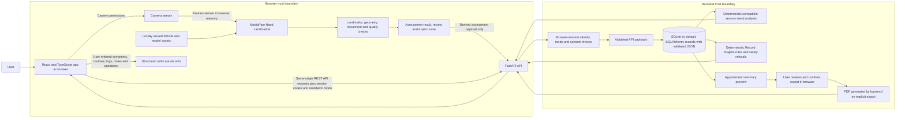

# ArthriTrack architecture and data flow

This diagram describes the current repository implementation. It is intended for the project submission and should be checked against the exact configuration used for the final demo.

## What the diagram means

- Camera capture and MediaPipe inference run in the browser. The app loads its local MediaPipe WASM/model assets from the frontend origin. Camera frames are not included in API requests; the API receives the derived assessment payload when the user saves it.
- Symptoms, routine definitions/status logs, report selections, notes, and questions are user-entered records. Real and demo records are separated by a mode field; demo mode is seeded with synthetic examples.
- The local API uses a random browser-session cookie whose hash is stored for identity. The default database is SQLite. Docker and PostgreSQL options exist, but this diagram does not claim a cloud deployment or external health-system integration.
- The progress service compares saved, compatible captures. **Record Insights** uses deterministic backend rules with validation/fallback; there is no active external LLM or WorkBuddy connection in the repository.
- Appointment summaries are previewed before export. The user reviews and confirms; PDF generation is an explicit export action. No automatic sharing is implemented.
- Captures are experimental estimates. Neither this architecture nor a successful software run demonstrates clinical accuracy, clinical validation, or a diagnosis.

## Source locations

- Browser flow: `frontend/src/pages/Assessment.tsx`, `frontend/src/vision/engine.ts`, `frontend/src/vision/geometry.ts`, `frontend/src/vision/calibration.ts`, `frontend/src/vision/`
- API and session/storage: `backend/app.py`, `backend/alembic/`, `backend/requirements.lock.txt`
- Trend and insight rules: `backend/services/analytics.py`, `backend/services/provider.py`
- PDF: `backend/services/reports.py`, with preview/export routes in `backend/app.py`
- Setup and local/Docker configuration: `README.md`, `start-backend.ps1`, `docker-compose.yml`, `backend/Dockerfile`, `frontend/Dockerfile`

